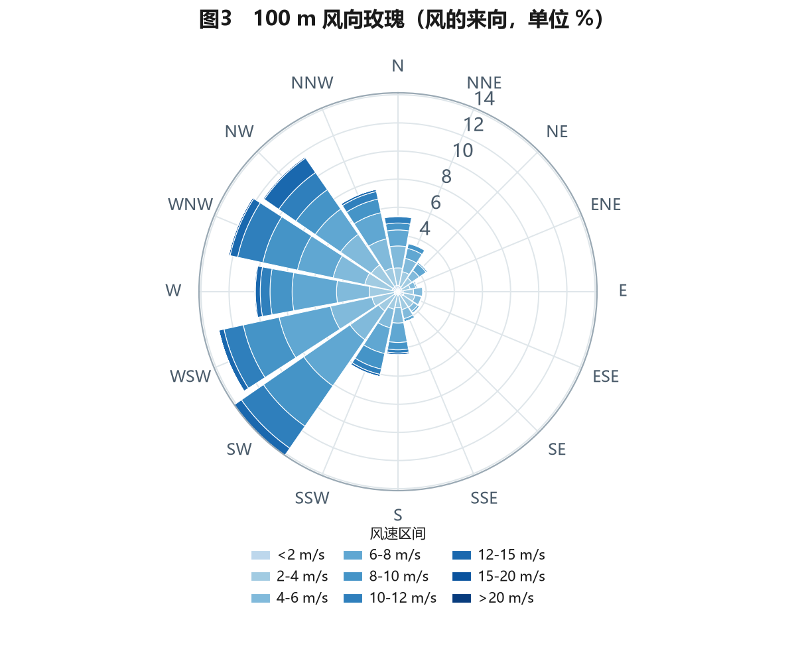

# ERA5 风资源评估复现｜内蒙古辉腾锡勒

用公开的 ERA5 再分析资料，把风电项目"风资源评估"这条链路完整跑一遍：
**数据获取 → 质控 → Weibull 拟合 → 风切变与轮毂高度外推 → 风玫瑰 → 年发电量估算 → 不确定性分析**。

目的不是替代工程咨询，而是验证一件事：**能不能把气象数据变成电站能用的结论，并且说清每一步的假设和误差。**



## 关键结果（2024 年，逐小时，8784 个时次）

| 指标 | 结果 |
|---|---|
| 站点 | 内蒙古乌兰察布辉腾锡勒（41.25°N, 112.75°E，海拔 2002 m） |
| 100 m 年平均风速 | **6.38 m/s** |
| 轮毂 110 m 外推风速 | **6.51 m/s**（α = 0.209） |
| Weibull 参数 | k = 2.25，c = 7.20 m/s |
| 风功率密度 | **226 W/m²** |
| 单机年净发电量 | **11.84 GWh**（5.0 MW / Φ156 m 代表性机型） |
| 容量系数 | **27.0%** |
| 等效满发小时 | **2368 h** |
| 主导风向 | SW（14.1%）、WSW（13.0%）、WNW（12.3%） |

> 完整分析见 [`report/辉腾锡勒风资源评估报告.pdf`](report/辉腾锡勒风资源评估报告.pdf)（7 页，含全部图表与局限说明）。

## 为什么做这个项目

我原来的科研训练是"观测—建模—分析"，处理过地面观测、ERA5 和卫星产品。但那是**科研语言**，不是**工程语言**。
这个项目做的事，是把同一批数据换成风电行业的问法：

- 这地方的风值不值得开发？（风功率密度、Weibull）
- 风机立 110 m 高，风速是多少？（风切变、幂律外推）
- 一年能发多少电、能赚多少？（AEP、容量系数）
- 结论有多可信？（敏感性、网格代表性、数据源局限）

## 数据

| 项目 | 说明 |
|---|---|
| 来源 | ERA5 再分析（ECMWF），经 [Open-Meteo Archive API](https://open-meteo.com/en/docs/historical-weather-api) 获取，**无需注册** |
| 变量 | 10 m / 100 m 风速风向、2 m 气温、地面气压 |
| 分辨率 | ERA5 原生 0.25°（约 31 km），逐小时 |
| 时段 | 2024-01-01 ~ 2024-12-31 |
| 许可 | ERA5 © Copernicus Climate Change Service；API 数据 CC BY 4.0 |

数据已随仓库提交（`data/raw/`，约 470 KB），保证 clone 下来就能复现。

## 方法

1. **质控**：物理限值（0–50 m/s）、僵值（连续 6 h 相同）、变化率（相邻小时差 > 15 m/s）、缺测线性插补（≤3 h）。
2. **Weibull 拟合**：两参数极大似然估计，对 k 用 Brent 求根；KS 检验评估拟合优度。
3. **风切变**：逐时 α = ln(v₁₀₀/v₁₀)/ln(10)，取中位数；幂律外推 v₁₁₀ = v₁₀₀·(110/100)^α。
4. **风玫瑰**：16 方位 × 9 个风速区间，按频率堆叠，风向为来向。
5. **发电量**：空气密度修正（ρ = p/RT，IEC 等功率法 v_eq = v·(ρ/1.225)^(1/3)）→ 风速分箱 → 机型功率曲线积分 → 逐项折减（尾流 6%、可利用率 3%、电气 2%、限电 2%）。

## 结果解读

- **季节差异极大**：12 月容量系数 39.4%，7 月只有 8.7%，峰谷比 4.53——这就是年度检修必须安排在夏季的原因。
- **风向集中**：SW–WNW 三个方位占了约 39% 的频率，且这些方位的平均风速最高（7.2–7.4 m/s），机组排布要正对主风向、控制尾流。
- **风切变偏高**（α = 0.209）：高原春季大风、层结不稳定，外推到 110 m 只增加 2%，但 α 的不确定性会直接传导到发电量。
- **敏感性**：风速 ±10% → 发电量 ±22%。所以测风塔的标定和长期维护，比换一个更复杂的模型更值钱。

## 局限（重要）

这是一份**基于再分析资料的方法复现**，不是工程咨询结论：

1. **ERA5 会低估复杂地形风速**，且 0.25° 网格内差异很大——本场周边相邻格点 100 m 年均风速分别为 6.38 与 5.20 m/s（差 23%）。实际项目必须用至少一整年的测风塔实测数据。
2. 只有 10 m / 100 m 两层，无法刻画稳定度对风廓线的影响。
3. 尾流按整场 6% 粗略折减，未做机位级尾流计算。
4. 功率曲线是代表性曲线，非厂商实测。
5. 单年样本，不能代表长期气候态。

## 快速开始

```bash
pip install -r requirements.txt
python run.py            # 有本地数据则复用，否则自动下载
python run.py --refresh  # 强制重新下载 ERA5
```

输出：

```
output/figures/   6 张图（质控、Weibull、风玫瑰、时间变化、风切变、AEP）
output/tables/    质控报告、月度发电量、敏感性、16 方位玫瑰、summary.json
report/           自包含 HTML 报告 + 已导出的 PDF
data/processed/   质控后的逐小时数据
```

**换一个场址**：只改 `src/config.py` 里的 `SITE`（经纬度、轮毂高度）和 `TURBINE`，重跑即可。

## 目录结构

```
├── run.py                  # 一键流水线
├── src/
│   ├── config.py           # 站点 / 机型 / 折减假设（所有假设集中在此）
│   ├── fetch.py            # ERA5 获取（Open-Meteo）、本地读取
│   ├── analysis.py         # 质控 / Weibull / 风切变 / 风玫瑰 / AEP / 敏感性
│   ├── plots.py            # 6 张图
│   └── report.py           # 生成自包含 HTML 报告
├── data/raw/               # ERA5 原始数据 + 元数据
├── output/                 # 图与表
└── report/                 # HTML + PDF
```

## 可以继续做的方向

- [ ] 用 10 年以上 ERA5 做长期订正（MCP：测量-相关-预测）
- [ ] 接入 Jensen/PARK 尾流模型，做机位排布优化
- [ ] 加入 ERA5-Land / CERRA 做多源对比，量化再分析的空间偏差
- [x] 用同一套数据做功率预测 baseline（persistence vs 回归），算 RMSE / 准确率 → 见 [`wind-power-forecast`](https://github.com/Lvy-cyber/wind-power-forecast)

## 项目小结

> **基于 ERA5 的内蒙古某风电场风资源评估复现**
> Python / pandas / scipy / matplotlib
> - 处理 8784 小时 ERA5 逐时数据（10 m / 100 m 风速、温压），建立质控流程（物理限值、僵值、变化率、插补），并用注入已知错误的方式回检检出能力；
> - 完成两参数 Weibull 极大似然拟合（k=2.25, c=7.20）、逐时风切变估计（α=0.209）与轮毂高度外推，量化风功率密度 226 W/m²；
> - 基于机型功率曲线与空气密度修正估算年发电量，单机净发电 11.84 GWh、容量系数 27.0%，并完成风速 ±10% 与折减 ±3pp 的敏感性分析；
> - 输出 7 页评估报告与可复现代码库，明确标注再分析资料的空间代表性与使用边界。

## 数据与工具声明

- ERA5 数据 © Copernicus Climate Change Service / ECMWF，经 Open-Meteo 获取（CC BY 4.0）。
- 风机功率曲线为公开资料的**代表性曲线**，不代表任何厂商型号。
- 本项目为方法复现，不构成工程咨询意见。
